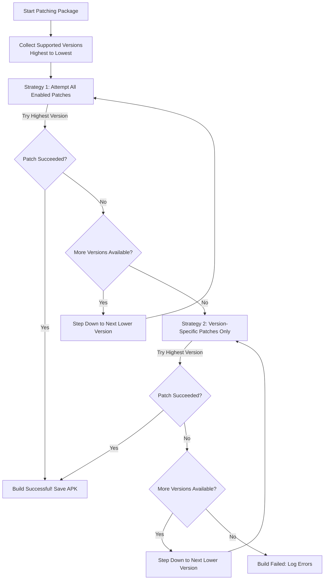

[🏠 Documentation Hub](README.md) › **User Guide & Configuration**

---

# AutoMorph User Guide & Configuration

Welcome to the AutoMorph user guide! This document explains how to use the web interface to configure packages, customize patch options, manage build schedules, and download patched APKs.

---

## Table of Contents

- [1. Web Interface Overview](#1-web-interface-overview)
- [2. Adding & Managing Packages](#2-adding--managing-packages)
  - [2.1 Add Package Wizard](#21-add-package-wizard)
  - [2.2 Choosing Patch Repositories](#22-choosing-patch-repositories)
  - [2.3 Enabling and Disabling Apps](#23-enabling-and-disabling-apps)
- [3. Customizing Patch Options & Patch Aliases](#3-customizing-patch-options--patch-aliases)
  - [3.1 Patch Selection & Options](#31-patch-selection--options)
  - [3.2 Patch Aliases (Cross-Repository Patch Mapping)](#32-patch-aliases-cross-repository-patch-mapping)
- [4. Triggering Builds & Patching Strategies](#4-triggering-builds--patching-strategies)
  - [4.1 Manual Single or Batch Builds](#41-manual-single-or-batch-builds)
  - [4.2 Scheduled Automated Builds](#42-scheduled-automated-builds)
  - [4.3 Patching Strategies & Fallback Flow (Strategy 1 vs. Strategy 2)](#43-patching-strategies--fallback-flow-strategy-1-vs-strategy-2)
- [5. System & Performance Settings](#5-system--performance-settings)
  - [5.1 Low-Spec Mode (Recommended for Free Tier)](#51-low-spec-mode-recommended-for-free-tier)
  - [5.2 Timezone & Schedule Time](#52-timezone--schedule-time)
  - [5.3 Retention & Storage Cleanup](#53-retention--storage-cleanup)
- [6. Custom Keystore & Seamless Updates (Morphe App Compatibility)](#6-custom-keystore--seamless-updates-morphe-app-compatibility)
  - [6.1 Why Keystores Matter for Updates](#61-why-keystores-matter-for-updates)
  - [6.2 Exporting and Placing Your Keystore](#62-exporting-and-placing-your-keystore)
- [7. Email Dispatcher & Notifications](#7-email-dispatcher--notifications)
  - [7.1 ntfy Push Notifications](#71-ntfy-push-notifications)
- [8. Downloading Builds](#8-downloading-builds)

---

## 1. Web Interface Overview

Once you navigate to your AutoMorph portal (via your [configured tunnel](tunnels.md) or local address), the dashboard displays:
* **System Status & Stats**: Total tracked packages, last build timestamp, and next scheduled run.
* **Tracked Applications List**: Cards showing version numbers, current patch status, and download links.
* **Console & Real-time Logs**: Live build status streamed directly to your browser when a build is underway.

---

## 2. Adding & Managing Packages

### 2.1 Add Package Wizard
1. On the dashboard, click **Add Package** (or **+**).
2. Enter the package name (e.g. `com.reddit.frontpage` or `com.google.android.youtube`).
3. AutoMorph automatically checks Google Play and fallback sources (APKCombo, Uptodown, APKPure) to detect valid versions and metadata.

### 2.2 Choosing Patch Repositories
Specify which patch repository to use for the app (e.g., ReVanced, Morphe patches, or custom community repositories). AutoMorph queries the repository releases and discovers compatible patches.

### 2.3 Enabling and Disabling Apps
Each app card features a toggle switch:
* **Enabled (ON)**: Included in daily scheduled patching checks.
* **Disabled (OFF)**: Kept in your configuration but skipped during automated runs.

---

## 3. Customizing Patch Options & Patch Aliases

For any package, click **Options** / **Customize Patches** to open the package configuration modal.

### 3.1 Patch Selection & Options
* **Explore Patches**: View all available patches provided by your configured repositories.
* **Toggle Patches**: Switch individual patches ON or OFF (e.g., enable custom branding, remove ads, or disable debugging).
* **Configure Values**: Edit patch option values where supported (e.g., custom package names, user-agent overrides).
* **Save Changes**: Click **Save Options** to persist your selections.

### 3.2 Patch Aliases (Cross-Repository Patch Mapping)
When you enable patches from two or more repositories (for instance, the official Morphe patches and community or ReVanced repositories), different repositories often contain patches that perform the exact same role under different names (e.g., `Unlock Premium` vs. `Enable Premium`, or `Hide Ads` vs. `Ad-blocker`).

Without patch aliases, having both patches enabled could cause collisions or patch failures when switching between versions.

#### How Patch Aliases Work:
1. **Define an Alias Name**: Create a new alias and give it any name you like (e.g., `Unlock Premium`). *The only restriction is that the alias name must not match the exact name of another already enabled patch.*
2. **Assign Patches per Repository**: Use the dropdown menus for each configured repository to select which patch fulfills that alias role in that specific repository.
3. **Dynamic Version-Aware Selection**: During build time, AutoMorph inspects the package version currently being targeted:
   * If a repository's aliased patch is not compatible with the target version, AutoMorph automatically disables it in that repository's options.
   * If a repository's aliased patch matches the target version, AutoMorph automatically enables it.

> [!TIP]
> Patch aliases prevent conflicts when combining multiple repositories and ensure that AutoMorph always picks the right patch for the specific version being patched without any manual intervention.

---

## 4. Triggering Builds & Patching Strategies

### 4.1 Manual Single or Batch Builds
* **Single App**: Click the **Run** button on an individual app card to trigger patching for just that package.
* **Run All**: Click **Start Build** in the top navigation bar to run through all enabled packages.
* During patching, a slide-out console displays progress output in real time.

### 4.2 Scheduled Automated Builds
AutoMorph includes an internal daily scheduler. It runs automatically once every 24 hours at the time configured in your system settings.

### 4.3 Patching Strategies & Fallback Flow (Strategy 1 vs. Strategy 2)
When AutoMorph begins patching a package, it collects the supported package versions across all enabled patches and sorts them from highest to lowest. It then runs through an automated two-stage patching pipeline:



#### Strategy 1: All Enabled Patches (Force Mode)
* **How it works**: AutoMorph attempts to apply **all enabled patches** to the highest listed supported package version (running Morphe CLI with `--force`).
* **Fallback**: If patching fails (for example, if a newly released app version changed bytecode that a particular patch cannot yet handle), AutoMorph does not immediately give up. It moves down the version list, attempting to patch the next lower supported version with all enabled patches.
* **Goal**: Maximizes feature coverage by trying to give you every patch you asked for on the most modern version possible.

#### Strategy 2: Version-Specific Patches Only (Strict Compatibility Mode)
* **When it activates**: If all supported versions fail under Strategy 1, AutoMorph skips to Strategy 2.
* **How it works**: AutoMorph resets back to the top of the version list, but this time **only enables patches that are explicitly declared compatible with that exact version** (plus universal patches with no version restrictions). Any patch not certified for that version is excluded.
* AutoMorph works down the version list under Strategy 2 until it finds a combination that builds cleanly.
* **Goal**: Guarantees you still get a working, stably patched application even if certain cutting-edge patches are not compatible with newer versions.

---

## 5. System & Performance Settings

Access the **Settings** tab in the top navigation bar to fine-tune your environment:

### 5.1 Low-Spec Mode (Recommended for Free Tier)
* **What it does**: Optimizes memory allocation and builds packages sequentially with garbage collection between steps.
* **When to enable**: Essential when hosting on an [Oracle Free Tier E2.1.Micro instance](oracle-setup.md) with 1 GB RAM to prevent out-of-memory errors.

### 5.2 Timezone & Schedule Time
* **Schedule Time**: Specify when daily runs should execute (e.g., `03:00` for 3:00 AM).
* **Timezone**: Set your local IANA timezone (e.g., `America/New_York`, `Europe/London`, `Asia/Tokyo`) so schedules match your local time.

### 5.3 Retention & Storage Cleanup
To prevent your storage disk from filling up:
* **Max Original Packages**: Number of downloaded source APKs to keep per app before pruning old versions.
* **Max Patched Packages**: Number of completed patched APKs to retain per app.
* **Max Logs**: Number of historical build log files to keep.

---

## 6. Custom Keystore & Seamless Updates (Morphe App Compatibility)

AutoMorph signs all patched APKs so they can be installed directly on Android devices. To make updates as smooth as possible, you can provide your own signing keystore.

### 6.1 Why Keystores Matter for Updates
On Android, an existing app can only be updated if the new APK is signed with the **exact same cryptographic key and certificate** as the currently installed version.

If an update is signed with a different key, Android will refuse the installation with a signature mismatch error (e.g., *“App not installed as package appears to be invalid”*). To install it, you would have to uninstall the app, wiping all user data and settings.

By sharing a keystore:
* APKs built by AutoMorph can be installed directly over apps patched on your phone using the Morphe app.
* Apps patched by the Morphe app can be updated directly over APKs built by AutoMorph.
* Builds can upgrade over older AutoMorph installations seamlessly.

### 6.2 Exporting and Placing Your Keystore

AutoMorph's patching engine looks for keystore files in the Morphe data root directory: `tools/morphe-data/`.

Because `./tools/morphe-data` is mounted to `/automorph/tools/morphe-data:rw` in `compose.yaml`, files placed in this folder on your host machine are immediately available to the patcher and persist across container updates.

#### Step-by-Step Instructions:
1. **Export from the Morphe Android App** (if using the mobile app):
   * Open the **Morphe app** on your Android device.
   * Navigate to **Settings** › **Keystore**.
   * Tap **Export keystore** and save the file (e.g., `morphe.keystore`).
2. **Place the File in AutoMorph**:
   * Copy your exported keystore file into the `tools/morphe-data/` folder on your AutoMorph host:
     ```bash
     cp /path/to/exported.keystore ./tools/morphe-data/morphe.keystore
     ```
   * Ensure the file is named `morphe.keystore` (or `Morphe.keystore`).
3. **Automatic Detection**:
   * AutoMorph will automatically use this keystore for all subsequent builds. No restart or container rebuild is required!

> [!NOTE]
> If you do not provide a custom keystore, AutoMorph will automatically generate a default keystore in `tools/morphe-data/` upon its first build and continue reusing it for all future builds.

---

## 7. Email Dispatcher & Notifications

AutoMorph can send rich email build reports directly to your inbox whenever patching completes.

1. Ensure `SMTP_USERNAME` and `SMTP_PASSWORD` are defined in your `.env` file (see [Oracle Setup](oracle-setup.md#32-configure-env)).
2. In the web portal, launch the **Email Settings Wizard** under Settings.
3. Configure:
   * **Sender / Recipient Email**: Address to deliver notifications to.
   * **SMTP Host & Port**: (e.g., `smtp.gmail.com` on port `587`).
4. Click **Send Test Email** to verify your configuration.

Each report contains direct download links, checksums, and patch summaries.

### 7.1 ntfy Push Notifications

[ntfy](https://ntfy.sh) sends the build summary to your phone as a push notification, so
you do not need a mail server. It runs independently of the email dispatcher, and you can
use one, the other, or both.

You can set it up in the portal or by editing the config file. The portal is quicker,
because it tests the connection before anything is saved.

In the portal, the Settings tab has an ntfy card that shows the current server, topic,
authentication and delivery settings. Its Edit button opens a wizard with three steps:

1. Server and topic. Choose `ntfy.sh`, `ntfy.envs.net` or `ntfy.adminforge.de`, or enter
   the address of your own instance, then the topic you subscribe to in the ntfy app. A
   token, or a username and password, is only needed when the instance protects the topic.
2. Delivery and options. Default priority from `min` to `max`, which runs notify
   (`always`, `success`, `failure`), tags, and the URL that opens when you tap the
   notification.
3. Review and test. The wizard shows the settings in a table and offers *Send Test
   Notification Now*, which publishes a real message before you save.

The wizard writes the same values to `tools/automorph-data/config.yaml`:

```yaml
ntfy:
  enabled: true
  server: "https://ntfy.sh"        # or your self-hosted instance
  topic: "automorph"
  token: ""                        # access token for protected topics
  priority: "default"              # min | low | default | high | max
  tags: "robot,package"
  click_url: "https://patcher.example.com"   # opened when tapping the notification
  notify_on: "always"              # always | success | failure
```

Environment variables override the config file: `NTFY_ENABLED`, `NTFY_URL` (server, or a
full `https://server/topic` URL), `NTFY_TOPIC`, `NTFY_TOKEN`, `NTFY_USERNAME`,
`NTFY_PASSWORD`, `NTFY_PRIORITY`, `NTFY_TAGS`, `NTFY_CLICK_URL`, `NTFY_NOTIFY_ON`.

A notification lists one line per built app with its version and download URL, then one
line per failure with the reason, then the totals and how long the run took. When a tunnel
or `NTFY_CLICK_URL` is set, tapping the notification opens the portal. Failures arrive with
`priority: high` and a warning tag, successes with a check mark.

> [!NOTE]
> Instances with `auth-default-access: deny-all` answer `403 Forbidden` to anonymous
> publishing. Create an access token (or a user) for the topic, then enter it in the wizard
> or pass it as `NTFY_TOKEN` (sent as the bearer token) or as
> `NTFY_USERNAME`/`NTFY_PASSWORD`.

> [!WARNING]
> The portal has no login of its own, so the API never returns the ntfy token or password.
> The wizard only reports whether a credential is stored, and an empty field keeps the
> stored one. Anyone who can reach the portal can still use those credentials, and anyone
> who can read `config.yaml` on the host can read them. If that matters, set the token
> through `NTFY_TOKEN` in the container environment, and keep the portal on a private
> network or behind a reverse proxy that asks for authentication.

Verify the setup without running a build:

```bash
curl -X POST http://localhost:8080/api/settings/ntfy/test -H 'Content-Type: application/json' -d '{}'
# or from the CLI:
python3 scripts/ntfy_notify.py --dry-run     # print the payload only
NTFY_URL=https://ntfy.example.com/automorph NTFY_TOKEN=… python3 scripts/ntfy_notify.py
```

---


You can download completed APKs through multiple avenues:
1. **Web Dashboard**: Click the **Download** button directly on any completed app card.
2. **Notification Emails**: Click the branded download button corresponding to your active tunnel ([Pangolin, Tailscale, or Cloudflare](tunnels.md)).
3. **Mounted Volumes**: Built APKs are stored in the `./apps` directory on the host machine.

---

[← Previous: Remote Access & Tunnels Guide](tunnels.md) | [Documentation Hub](README.md)
